# Arquitetura e evolução

## Decisão inicial

Next.js App Router, TypeScript/React, CSS responsivo próprio e ícones Lucide. Backend Node.js 24 com SQLite nativo (`node:sqlite`), sem serviço de autenticação externo. A configuração evita despesas de APIs na Fase 1 e permite executar o fluxo sem credenciais de marketplaces. PostgreSQL/Supabase continuam sendo opções futuras; não há integração fictícia nem compatibilidade com PostgreSQL já implementada.

O domínio puro está em `domain.ts`; acesso ao banco e invalidação de aprovações em `repository.ts`; autenticação e criptografia em `auth.ts`. A API valida dados com Zod, aplica permissões em cada operação e mantém transações. Migrações SQL versionadas são aplicadas ao abrir o banco. Não há cadastro aberto, papel escolhido pelo cliente ou senha inicial compartilhada.

## Fluxo de confiança

```mermaid
flowchart LR
    A[Texto colado] --> B[Parser: candidatos não salvos]
    B --> C[Revisão humana e cadastro de regras]
    C --> D[Oferta + produto + vendedor + grupo]
    D --> E[Elegibilidade e preço teórico]
    E --> F[Revisão e aprovação]
    F --> G[Gerar e editar rascunho]
    G --> H[Copiar e publicar manualmente]
    H --> I[Declaração explícita de publicação]
```

Copiar não declara envio. Publicações preservam uma cópia imutável do texto, grupo, pessoa e horário. Alterações relevantes invalidam a aprovação e incrementam a versão da oferta; rascunhos guardam a versão de origem. Divergências de seller ID geram alerta e impedem aprovação, sem substituir o vendedor automaticamente. Uma conferência correta pode resolver o alerta. Não há revalidação automática.

Cupons têm regras normalizadas, fonte e texto original. Datas são armazenadas em UTC e exibidas em America/Sao_Paulo. Importar texto não produz status verificado: uma declaração de evidência separada é necessária, e mesmo assim outras compras continuam estimativas. Pagamento/público específicos ainda não possuem comprovação por compra; ficam pendentes em vez de aplicar desconto automaticamente. Não há cumulatividade, cashback ou frete presumidos.

## Persistência e identidade

Migrations incluem usuários, papéis, permissões, auditoria, plataformas, integrações e execuções, fontes, vendedores, produtos, anúncios, observações, cupons/regras/fontes/verificações, ofertas, links, grupos, associações, modelos, rascunhos, publicações, alertas, listas de interesse e feedback. Tabelas de automações futuras são somente estrutura: não têm interface ou job que aparente funcionar.

Vendedor: identidade única por plataforma e ID. Produto: plataforma + ID do anúncio + variação normalizada. Oferta: produto/variação + vendedor + dia UTC. É uma proteção de duplicidade de janela diária; não identifica produtos equivalentes em anúncios diferentes. Uma edição é explícita e auditada. Cadastros ligados a exemplos mantêm rótulo de exemplo.

## Limites operacionais

- Um servidor/processo, com volume local persistente. Sem réplicas independentes ou funções efêmeras. SQLite é suficiente para a equipe inicial; PostgreSQL será uma migração real, envolvendo SQL, transações, migrations e testes, antes de escala horizontal.
- A conta inicial é criada no terminal do servidor. Convites são gerados pelo administrador e enviados fora do aplicativo; sem serviço de e-mail contratado.
- Permissões são avaliadas no servidor; usuários desativados perdem acesso e alterações de permissões encerram sessões. Credenciais, usuários e configurações financeiras futuras são exclusivas do owner.
- Senhas scrypt, sessões de sete dias revogáveis, limites de login e gravação, validação de origem, cookies seguros em produção e segredos AES-GCM. Chaves não são versionadas nem devolvidas. CSP bloqueia frames e objetos; scripts inline exigidos pelo Next estão permitidos. MFA e recuperação por e-mail são melhorias pendentes.
- URLs têm validação superficial HTTPS e não são consultadas pelo backend. Não há resolução de links curtos, verificação de destino/vendedor ou garantia de comissão. A imagem é externa e exige autorização de uso. Nenhum upload/OCR foi exposto.
- Mensagens geradas usam apenas dados manuais. Edições humanas são livres e devem ser conferidas pelo operador. Os três estilos são modelos fixos; modelos personalizados por grupo são futuros.
- Amostragem histórica mínima de 10 observações em 7 dias distintos; o menor preço é somente do conjunto observado. Não representa cobertura histórica do mercado.
- Auditoria de trabalho e exportação JSON estão disponíveis. A restauração completa exige backup SQLite e preservação separada da chave. Retenção, descarte, MFA, monitoramento externo e revisão operacional de segurança devem evoluir conforme o uso.

## Custos

Não são feitas chamadas a APIs de IA ou marketplaces, e não há envio pago. Node/Next/SQLite não exigem assinatura para esta execução. Hospedagem com disco, domínio e backups externos podem custar; preços e planos gratuitos devem ser confirmados com o provedor antes de contratar. A assinatura ChatGPT não inclui créditos de API nem hospedagem. Fases futuras precisam avaliar orçamento e autorização antes de ativar serviços pagos.
